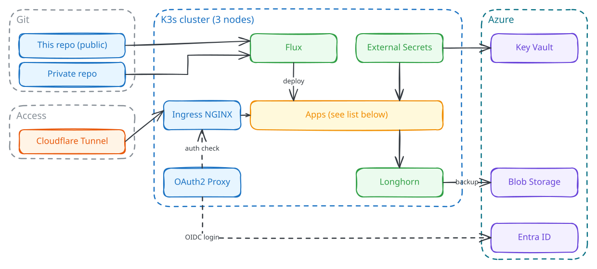

# Homelab

A three-node bare metal Kubernetes (K3s) cluster, managed entirely through Git with Flux. I run my portfolio site and a set of open source self-hosted apps on it, and use it to learn how to operate real infrastructure: networking, secrets, storage, backups, and what breaks.

I'm a computer science graduate looking for a cloud / platform role. This repo is the best description of how I work. My portfolio is at [dariomazza.net](https://dariomazza.net).


## At a glance

- 3 Dell Optiplex 7040 Micro (i5-6600T, 16 GB), Debian 13, K3s. No hypervisor.
- Everything in the cluster is deployed by Flux from this repo, plus a second private repo for personal workloads.
- Secrets live in Azure Key Vault and reach the cluster through External Secrets. No secret values in Git.
- Dependency updates arrive as Renovate pull requests. A CI job builds every kustomization before merge.
- Persistent volumes use Longhorn, with scheduled backups to Azure Blob Storage.

## Architecture



The diagram is drawn with [Excalidraw](https://excalidraw.com/); the editable source is [assets/architecture.excalidraw](assets/architecture.excalidraw).

- **Deploy:** Flux pulls both repos and reconciles the cluster. Terraform and Ansible are run by hand and are not part of the Flux loop.
- **Secrets:** Terraform creates the Key Vault and the Entra apps. External Secrets copies the values into the cluster.
- **Traffic:** public services go through a Cloudflare Tunnel. Admin tools are only reachable from the LAN or Tailscale, some behind OAuth2 Proxy with Entra ID.

## What runs on it

### Platform

| | App | What it does |
| :---: | :--- | :--- |
|  | [Flux](https://fluxcd.io/) | GitOps: applies this repo to the cluster |
|  | [Cilium](https://cilium.io/) | Networking (eBPF) and L2 load balancing |
|  | [Ingress NGINX](https://kubernetes.github.io/ingress-nginx/) | HTTP routing for every service |
|  | [cert-manager](https://cert-manager.io/) | Let's Encrypt certificates |
|  | [ExternalDNS](https://github.com/kubernetes-sigs/external-dns) | Creates DNS records on Cloudflare |
|  | [External Secrets](https://external-secrets.io/) | Syncs Azure Key Vault into Kubernetes secrets |
|  | [Longhorn](https://longhorn.io/) | Replicated volumes and backups to Azure |
|  | [OAuth2 Proxy](https://oauth2-proxy.github.io/oauth2-proxy/) | Entra ID login in front of admin tools |
|  | [cloudflared](https://www.cloudflare.com/products/zero-trust/) | Cloudflare Tunnel for public services |
|  | [Renovate](https://renovatebot.com/) | Dependency update pull requests |

### Observability

| | App | What it does |
| :---: | :--- | :--- |
|  | [Prometheus](https://prometheus.io/) | Metrics |
|  | [Grafana](https://grafana.com/) | Dashboards |

### Self-hosted apps

| | App | What it does |
| :---: | :--- | :--- |
|  | [Portfolio](https://dariomazza.net) | My own site: portfolio and resume, with a staging copy |
|  | [Sure](https://github.com/we-promise/sure) | Personal finance |
|  | [OpenGym](https://gitlab.com/duartesantos8/opengym) | Workout logbook |
|  | [Vocard](https://github.com/ChocoMeow/Vocard-Dashboard) | Discord music bot, with Lavalink and MongoDB |
|  | [subito-it-searcher](https://github.com/xDaryamo/subito-it-searcher) | My fork, customized for my needs: Telegram bot that alerts me about new marketplace listings |

### Home

| | App | What it does |
| :---: | :--- | :--- |
|  | [Home Assistant](https://www.home-assistant.io/) | Home automation |
|  | [Hyperion](https://hyperion-project.org/) | Ambient TV lighting |
|  | [Glance](https://github.com/glanceapp/glance) | Dashboard of my services |

### AI

| | App | What it does |
| :---: | :--- | :--- |
|  | [Hermes Agent](https://github.com/NousResearch/hermes-agent) | Personal agent I talk to through Telegram |

### Media

| | App | What it does |
| :---: | :--- | :--- |
|  | [Jellyfin](https://jellyfin.org/) | Media server |

## Decisions and trade-offs

- **Bare metal, no Proxmox.** The three mini PCs have 16 GB each, and I didn't want to give up RAM to a hypervisor. The cost: no snapshots of whole nodes, and a node failure means reinstalling it with Ansible.
- **Public repo plus private repo.** Flux reads both, so infrastructure and open-source apps are public and personal workloads are not. The cost: part of the cluster can't be read from this repo.
- **Cloudflare Tunnel for public services, Tailscale for the rest.** No port forwarding on the router. Admin UIs are never public. The cost: tunnel routes are configured in the Cloudflare panel, not in Git.
- **Longhorn on mini PCs.** Replicated volumes survive the loss of one node and give me backups to Azure. The cost: higher disk and network load, and a degraded volume while a node is down.
- **Key Vault plus External Secrets.** Secret values stay out of Git and have a single source. The cost: several secrets are still created by hand in Key Vault, and a Service Principal secret must be added manually at bootstrap.

## Known limits

- Single control plane. If it fails, workloads keep running but I can't change the cluster until it's back.
- Backups go to a single offsite location, on a schedule, keeping the last three copies. That's not a full 3-2-1 strategy. Some volumes are not backed up yet.
- State is spread over places outside Git: tunnel routes, Tailscale, some Key Vault secrets, the Hermes volume. A rebuild is documented but not tested end to end.
- The Kubernetes project retired Ingress NGINX in March 2026. Migrating to Gateway API or another controller is on my list.
- Cilium egress policies based on domain names (`toFQDNs`) don't work in this cluster yet, so egress is limited by IP ranges only.

## Repository layout

```text
ansible/          OS setup, K3s install, node maintenance
apps/             App manifests: base + staging / production overlays
clusters/main/    Flux entry point and dependency order
infrastructure/   Cluster controllers and their configs
monitoring/       Prometheus and Grafana stack
terraform/        Azure: storage, Key Vault, Entra apps (two stacks)
.github/          CI: build all kustomizations on pull requests
renovate.json     Dependency update rules
mise.toml         Tool versions used on my workstation
```

## Rebuild from scratch

1. **Azure:** apply the Terraform stacks `foundation`, then `security`. Add the secrets that Terraform doesn't create to Key Vault.
2. **Nodes:** `ansible-galaxy install -r ansible/requirements.yml`, then `ansible-playbook -i ansible/inventory.ini ansible/site.yml`.
3. **Flux:** bootstrap it on `clusters/main` of this repo and add the deploy key for the private repo.
   ```bash
   flux bootstrap github --owner=$GITHUB_USER --repository=homelab --path=clusters/main --personal
   ```
4. **External Secrets:** create the Service Principal secret once, by hand.
   ```bash
   kubectl create secret generic azure-secret-sp \
     --namespace external-secrets \
     --from-literal=client-id=$AZURE_CLIENT_ID \
     --from-literal=client-secret=$AZURE_CLIENT_SECRET
   ```
5. **Restore data:** restore volumes from Longhorn backups in Azure.
